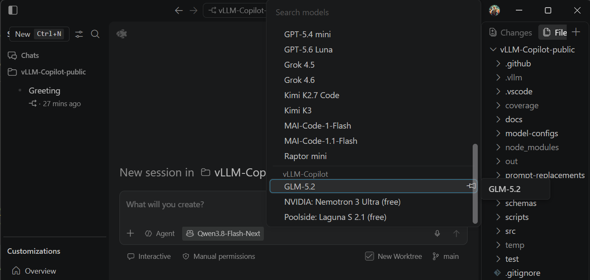

# Use vLLM models in the Agents window ("Open in Agents")

VS Code's Agents window opens a dedicated space for orchestrating agent sessions across workspaces. Its sessions run in a separate Agent Host process, which reaches extension-provider models through an experimental BYOK bridge instead of calling the provider directly.

vLLM-Copilot handles those settings automatically when at least one model is configured. The bootstrap runs during activation and again when the model setting changes, so the first model added after startup follows the same path as models that already existed when the window opened.

| Surface | What talks to your vLLM server |
|---|---|
| VS Code Copilot Chat (ask / edit / agent) | **vLLM-Copilot** - normal chat, everything works |
| **Agents window** (`Open in Agents`, Copilot harness) | **vLLM-Copilot** via Agent Host BYOK (this guide) |
| Terminal agent (`copilot`) | **Copilot CLI BYOK** ([guide](./copilot-cli.md)) |
| Scripts / CI / your own apps | **Copilot SDK** ([guide](./copilot-cli.md#scripting-and-ci-the-copilot-sdk)) |

---

## What the extension sets for you

| Setting | Why |
|---|---|
| `chat.agentHost.byokModels.enabled: true` | Lets Agent Host sessions use BYOK / extension-provider models. VS Code 1.146 ships it on by default, but the setting is tagged experimental and experiment-controlled, so the extension pins it to `true` rather than trusting the rollout. Without it the model picker never asks us for models. |
| `extensions.supportAgentsWindow: { "System-Sciences.vllm-copilot": true }` | The Agents window only activates extensions it considers supported. VS Code 1.137 and newer read our `capabilities.agentsWindow.supported` declaration in the manifest, so this entry is the door for 1.135 and 1.136 and the guarantee that outranks any product or experiment default on newer builds. |

Rules the bootstrap follows:

- **Your explicit values win.** A value you wrote yourself, including `false`, is never overwritten. For `supportAgentsWindow`, only this extension's entry is added and other extensions' entries are preserved.
- **Older VS Code is untouched.** Builds that do not register either setting receive no writes.
- **No empty opt-in.** The helper checks the effective model array and does nothing when no model is configured.
- **Idempotent.** Activation and later model-setting changes may call the helper repeatedly, but explicit values prevent duplicate writes.

## Requirements

1. **VS Code 1.135 or newer** for the current Agents-window extension bridge used by this feature.
2. **A tool-calling model.** Agent sessions hide models that do not declare tool calling. Serve the model with the matching vLLM tool parser and chat template, as described in the [Copilot CLI guide](./copilot-cli.md#vllm-server-requirements).
3. **Roomy context.** Agents accumulate file contents and tool results quickly; 128k or more tokens is recommended.

## Use it

1. Click **Open in Agents** in the title bar or run `Chat: Open Agents Window`. If the Agents window was already open before the extension was enabled, reopen it.
2. Start a new session, select the workspace, and choose the **Copilot** session target.
3. Open the model picker and select one of the vLLM-Copilot models.

Current VS Code versions synchronize the BYOK model bridge to a running Agent Host. A full VS Code restart is not normally required; restarting remains a fallback if an older host or an already open Agents window does not reload the extension opt-in.

## Which harness runs your chat

Both windows run the **Copilot harness** on current VS Code, and the main window is no longer the exception:

- Since VS Code 1.143, new sessions pick the Copilot harness by default in the editor's Chat view as well as in the Agents window. The Agent Host runs the session; the window is its client.
- VS Code 1.146 (2026-11-11) deprecated the **Local harness** and dates its removal to **February 2027**, calling it functionally frozen until then. Select **Local** in the Session Target picker while it exists to get the full mode and output-length controls; the enterprise opt-out `vscode.temporaryDefaultToLocalHarness` disappears with it.
- On the Copilot harness our provider answers through the BYOK bridge, so VS Code replaces our model entry with its own picker row: effort choices come from `copilotHarnessMapping`, and the tool ceiling and missing metadata are the upstream ones listed below.

Bridge limits, all upstream and all open as of 2026-11-11:

- **Remote sessions get no BYOK.** VS Code warns that BYOK models are unsupported in remote Copilot sessions ([microsoft/vscode#325738](https://github.com/microsoft/vscode/issues/325738)).
- **Subagents refuse BYOK models.** A BYOK model works as the session model, and the harness rejects it for subagents ([microsoft/vscode#333802](https://github.com/microsoft/vscode/issues/333802)).
- **Signed-out users still get pushed to sign in** even with our models visible ([microsoft/vscode#345315](https://github.com/microsoft/vscode/issues/345315)); the chat itself works once you are in.
- **The bridge has no commitment attached.** [microsoft/vscode#340335](https://github.com/microsoft/vscode/issues/340335) tracks Agent Host BYOK and names plugin-owned model providers as the intended long-term shape. Nothing there is implemented.

## Personalities work there too

The Agents window runs the **Copilot harness**, which ships its own system prompt
(Microsoft renames its boilerplate without notice, most recently "Copilot CLI
runtime" → "Copilot SDK" in 2026-11; it is a different text from the **Local
harness** prompt, reachable only by selecting **Local** in the Session Target picker). Your
configured **personality preset** applies there as well: the model gets your
persona's voice, the safety block is replaced by the user-owned security protocol
(risks are surfaced to you, you decide), and the "Co-authored-by: Copilot" commit
trailer instruction is removed. **Default** (no personality) leaves that prompt
untouched, as always. Rules that anchor this prompt carry `"scope": "copilot"`;
those bound to wording specific to the current prompt also carry `"wording": "sdk"`.
When Microsoft renames the prompt, the affected rules are re-anchored
rather than kept alongside the old text, so an Agents window older than the
current wording runs with vanilla identity until the extension catches up.
See [Two harnesses, two prompts](./manual.md#two-harnesses-two-prompts) in the Manual for the replacement mechanics.

## Fine print

- **Experimental.** Microsoft documents the BYOK bridge as experimental, and Agent Host sessions remain preview functionality. If the picker stays empty after reopening the Agents window, report it to VS Code first.
- **Reasoning rungs need no mapping.** A mode named with a harness effort token (`none`, `minimal`, `low`, `medium`, `high`, `xhigh`, `max`, `ultra`) publishes that value itself, so the Agents window renders its own label and hover text for the choice. `copilotHarnessMapping` is the exception, not the wiring: it exists only to point an effort at a *descriptively named* mode (a behavior such as `Think-Coding`), and it must cover the default mode unless that default is already a token. Presets alias every rung of a depth ladder so no Agents-window row depends on a raw string; a mode that is a domain rather than a depth stays Local-only. The harness shows standard effort labels; Local shows the mode identifiers and unmapped choices. Compatible existing model entries migrate automatically; unresolved cases need a manual mapping or Auto-Configure. **Output Length** and other provider metadata still need the [upstream fix](https://github.com/microsoft/vscode/issues/340138). See [migration and mapping policy](../model-configs/README.md#mode-identifiers-and-migration).
- **The tool budget is 128, hardcoded by VS Code.** The Agent Host caps every BYOK request at 128 tool definitions regardless of the model's or server's real capacity (its rationale is OpenAI's own 128-tool limit, which does not generalize to vLLM). Tools the conversation already called are kept first, the rest follows list order, and the overflow is dropped with a "The model only supports 128 tools" warning. There is no provider API or setting to raise it; "Configure Tools" is the only lever. We reported it upstream as [microsoft/vscode#347351](https://github.com/microsoft/vscode/issues/347351). **The cap is Agent Host only:** `BYOK_MAX_TOOLS = 128` and its single call site `capBridgeTools` live in `src/vs/platform/agentHost/node/copilot/` (verified against VS Code source 2026-11-10), and no tool-count constant exists in the workbench chat path, so a Local chat sends every tool the user has enabled.
- **Utility tasks** such as titles and commit messages use `chat.byokUtilityModelDefault`, which the extension sets to `mainAgent` unless you chose another value.
- **Local sessions keep the direct provider path** (no bridge, no 128-tool ceiling) while the Local harness exists. See [Which harness runs your chat](#which-harness-runs-your-chat) for its removal date.
- Agent Host sessions can use worktree isolation, MCP servers, hooks, and the usual agent customizations. Those are harness features and are outside this extension.
