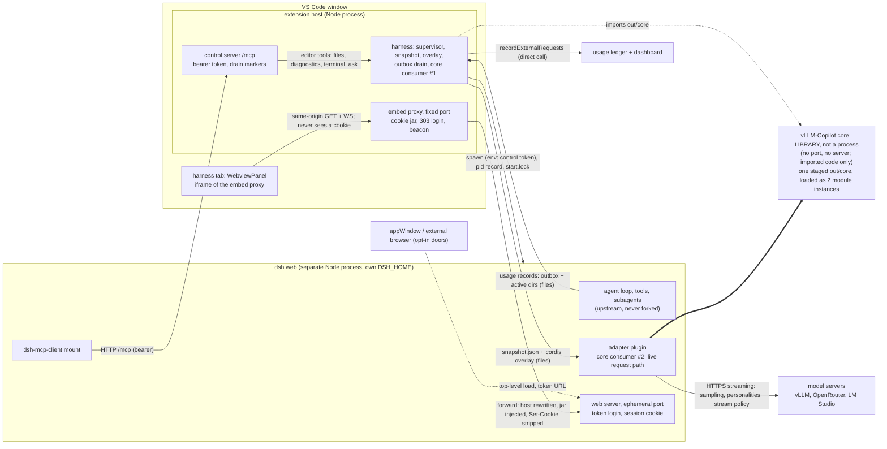

# DeepSeek Harness: the agent that runs on your own registry

The design law for the harness built into vLLM-Copilot: architecture, owner rulings, the adapter contract, the harness surface laws, and the verification gates. The user-visible surface spec is [harness-ui.md](./harness-ui.md). The dated decision journal, which is history rather than truth, is [harness-journal.md](./harness-journal.md). The open asks to the harness and to VS Code are [harness-upstream-issues.md](./harness-upstream-issues.md).

The harness reached this repository on 2026-11-14 as the merger of the retired `dsh-vllm-bridge` extension ([merger plan](extension-merger-plan.md)). Adapter contract spike-verified 2026-10-03 against dsh `0.2.0-rc.2` and dsh-llm's `LlmAdapter`.

## Intent

Local-model users want a real agent harness (sandboxed tools, subagents, sessions) without a single vendor login. DeepSeek Harness (dsh) is the strongest open harness and it already serves local models natively, so the missing piece is not another harness: it is a zero-config route from our model registry into it, with our request pipeline sitting in the middle. Users keep their vLLM and OpenRouter servers, their model modes, their personalities and their usage ledger, and get the whole dsh plugin ecosystem for free because we never fork dsh.

Copilot keeps taking model controls away, and editors such as VSCodium ship no Copilot at all. The harness answers both: an agent the user owns, running on servers the user already configured.

## Owner rulings (standing, do not re-propose around them)

1. **vLLM-Copilot sits in the middle** between the dsh agent loop and the real model servers. Nothing unaccounted-for may sit in that path: the adapter terminates the harness wire and speaks to the backends through the existing pipeline.
2. **dsh stays 100% upstream.** We contribute config overlays and supervision only, never a fork, never a patched install. Full compatibility with other dsh plugins is a consequence of not touching them.
3. **The harness owns the conversation, vLLM-Copilot owns the request.** dsh gets no say in how a model is addressed or parameterised. Its client contributes the message array, its own tool definitions, and a model id; our model configs (modes, sampling params, `chat_template_kwargs`, output budget, backend quirks, routing suffixes, headers) are applied by us on the way out. Their model intelligence in `compat` (`chatTemplateKwargs`, `chatTemplateArgs`, `vllmPriority`, `thinkingFormat`, reasoning switches) stays unset in the route profile, so no model behaviour is decided inside their process.
4. **Core consumption is staging, nothing else.** The extension stages its own compiled `out/core` into the harness home under a version stamp and installs the adapter plugin into the dsh profile as a `file:` package beside it, so pnpm links the core underneath. No npm publish pipeline, no git-tag dependency: tags carry source only.
5. **Dormant until installed** (owner ruling 2026-11-14). Before the user installs the harness, this feature contributes its commands, its sidebar section and its panel serializer, and nothing else: no folders, no status-bar pill, no ingest timer, no prerequisite probes, no notifications. A harness failure is logged and never reported as a vLLM-Copilot failure.
6. **No dependency on `NEXTINDIE/DeepSeek-Harness-for-VS-Code`** (MIT). Our client stands on its own feet; MIT code may be copied where they did good work, with attribution kept in `THIRD-PARTY-NOTICES.txt`.
7. **No second dsh extension, and no separate listing.** The harness is one feature of this product. While the retired `System-Sciences.dsh-bridge` extension is still installed, vLLM-Copilot refuses to install or start its own harness and says why in one modal notice that returns in every window until the bridge is gone: uninstall the old extension and reload the window before using this one. The two keep separate storage, and settings and sessions are not migrated. That check is scheduled for deletion once the old listing dies out.
8. **Users may add providers inside the harness**, as extra doors, never as a replacement. dsh's own `@deepseek-ai/dsh-llm-pi-ai` adapter ships enabled with zero routes, and the route name `vllmc` is ours; dsh refuses colliding route names at load. Traffic on those doors never reaches the usage totals, because the ledger is fed by the adapter. The README FAQ owns the recipe.
9. **Never commit hostnames, URLs of private servers, keys, or captured prompt text.** Config ids and server ids embed hostnames, so harness tooling output, fixtures and logs print only wire model ids and user-chosen display names. Public repo, assume every byte is read by strangers.
10. **The two interfaces own independent prompt choices** (owner ruling 2026-11-20). Copilot's per-model personality and `.vllm/system-messages.json` capture never reach dsh; the harness carries one session-wide personality file (`harness.personalityFile`, empty = upstream prompt untouched, user files under `<globalStorage>/harness-personalities/`), its four bundled voice presets (shipped in the extension-owned `harness-personalities/` dir and never seeded: each stores the portable NAME in `harness.personality`, wins over `personalityFile`, and is exactly one rule anchored on the recorded identity sentence, which is the ONLY prompt text a voice may touch - the restrained voices append one approved style sentence under it, the roast voices **Critical Senior Dev** and **Sarcastic Robot** replace it with at most three sentences of voice (owner ruling 2026-11-14), and the rest of the prompt ships upstream-untouched) and its own recording (`harness.captureSystemMessages` → `<workspace>/.vllm/dsh-system-messages.json`, an absolute path the preparing window names INTO the snapshot - the plugin never guesses a location; no workspace, no destination, no recording, no fallback). Copilot presets are never selected automatically for dsh: they target Microsoft's prompt text, and while shared substrings can coincide, only what a harness recording proves may anchor harness rules - the isolation exists so a Copilot rule never silently fires on dsh traffic. Recording consent is a single on-disk marker (`vllmc/capture.flag`) that must read byte-exactly `on`; missing, off, malformed (including whitespace or casing) or unreadable all mean off, and the adapter re-reads it at every request and again before each atomic commit - no restart, no polling, no IPC, and no snapshot-baked capture state. Prepare refuses to launch the harness when the marker write fails (never "follow the previous state"), and every window activation re-asserts the marker from the setting whenever a harness home exists, so an adopted survivor process cannot outlive an OFF made while the extension was closed. The consent marker lives in harness storage (`vllmc/capture.flag`), but recordings live in the workspace, so **Uninstall Harness** does NOT delete them and the confirmation says so; legacy recordings an old version left in the harness home go with it, and personality files live outside and persist. Ownership is explicit: one shared dsh has one recording target - the workspace that last PREPARED it, and since a Start that adopts a survivor SKIPS prepare, re-pointing a running harness means **Restart**, never a Start that quietly rebinds nothing. An adopting window names that destination instead of silently rerouting into it; the gate re-checks the target at every commit, so window B's prompts never sneak into window A's file after the snapshot moved on. Independent processes sharing one workspace file serialize on an exclusive lock file beside the target (`wx` create; content: pid + timestamp, authorizing nothing): waits are bounded with consent re-checked per poll, a denied lock SKIPS the capture with a named warning, and a stale lock from a crashed writer is NEVER stolen - the warning names the file for manual deletion, because recording blocked beats locks stolen and records rewritten.

## Layout and dependency law

| Path | Responsibility |
|---|---|
| `src/vscode/harness/harness.ts` | Editor glue: commands, lifecycle, panels, supervision wiring; exports `activateHarness(context)` |
| `src/vscode/harness/settings.ts` | The `vllm-copilot.harness.*` reads, over `getConfig()` and the core types |
| `src/vscode/harness/editor-tools.ts` | The MCP tool implementations that need the editor |
| `src/vscode/harness/` (the rest) | Node-only modules: bridge orchestration, supervisor, start lock, runtime install, preflight, paths, snapshot, ingest, embed proxy, control server, served-urls, disk |
| `src/vscode/ui/harnessView.ts` | The **DeepSeek Harness** sidebar section, the feature's entry point |
| `dsh/plugin/` | The adapter plugin loaded inside dsh: plain Node, zero `vscode` imports |
| `dsh/shared/` | The overlay composer and the core-staging helpers, shared by the extension and the rails |
| `dsh/dsh.json` | The certified `@deepseek-ai/dsh` pin |
| `scripts/harness/` | The developer rails (`stage-core`, `step2-boot-check`, `step3-bridge-check`, `live-harness`, `dsh-fresh`, `dsh-version`, `generate-overlay`, `build-pill-font`) |
| `test/harness/` | Harness unit tests, run by `npm test` against source |
| `test/e2e/` | Editor-driven scenarios, including `stale-tab.e2e.ts` and `embedded.e2e.ts` |

Four gates hold that shape, all in `.dependency-cruiser.cjs` and its pre-compilation twin `.dependency-cruiser.consumers.cjs`:

- `copilot-not-harness` and `harness-not-copilot`: `src/vscode/copilot/` and `src/vscode/harness/` never import each other, not even type-only. Both build on `src/core` and `src/vscode/state`.
- `harness-node-only`: every harness module except the three editor-glue files imports no host source outside `src/vscode/harness/`, so it runs and tests in plain Node.
- `harness-node-only-no-packages`: that Node-only half pulls no npm package at all, which is also how `vscode` is banned from it.
- `core-no-host`: the core stays free of both interfaces.

## Architecture

```mermaid
flowchart LR
    subgraph DSH["dsh (upstream, its own Node process)"]
        LOOP[agent loop, tools, sandbox,<br/>subagents, plugins]
        ADP[our LlmAdapter plugin:<br/>yields StreamChunk]
    end
    subgraph EXT["vLLM-Copilot extension host"]
        REG[registry + catalog]
        HAR[supervisor: detect, install, launch, health]
        GEN[overlay generator: privacy + persona rows]
        CFGW[config writer: registry to file]
        LEDGER[canonical usage owner + dashboard]
    end
    CORE[staged copy of the compiled core<br/>inside the harness home]
    LOOP -->|"GenerateOptions"| ADP
    ADP -->|"StreamChunk"| LOOP
    ADP -->|request path| CORE
    REG -.config snapshot.-> CFGW
    CFGW -.writes config file.-> ADP
    ADP -.completed request records.-> HAR
    HAR -.recordExternalRequests.-> LEDGER
    CORE --> SRV[vLLM, OpenRouter, LM Studio, ...]
    GEN -.writes cordis.patch.yml.-> DSH
    HAR -.spawns.-> DSH
```

The adapter is a cordis plugin loaded inside dsh's process. It implements dsh-llm's `LlmAdapter` contract: one required method, `stream(options: GenerateOptions): AsyncIterable<StreamChunk>`. It projects dsh input into the core's request path and yields `StreamChunk` objects back. There is no bridge HTTP listener, port, Bearer token, or SSE re-emission; backend HTTP and SSE parsing stays in the core. Failures still need translation into dsh's error taxonomy.

The extension host writes a versioned config snapshot into the harness home containing the effective registry and model settings, the required toggles, and explicit personality paths; the plugin reads that snapshot. Personality selection goes through `resolveModelReplacements()`, so a built-in preset picked in Model Settings reaches the harness; the retired bridge could only pass personality files given as absolute paths. Settings changes rewrite the snapshot and restart dsh under an explicit active-request drain policy. The core runs in each consumer's process, not through a request proxy.

The process boundary stays because it is real: dsh is a separate Node process, the plugin runs inside it, and the completed records come back over files. Outbox record validation stays for the same reason, even though the ledger call is now a function call.

### Adapter contract (dsh-llm, spike-verified 2026-10-03)

`@deepseek-ai/dsh-llm` exports an abstract `LlmAdapter` class. The contract:

- **Required:** `abstract stream(options: GenerateOptions): AsyncIterable<StreamChunk>`. The only method that must be implemented.
- **Optional overrides:** `providerInfo`, `providerRetryPolicy`, `imageRequestPricing`, `listModels`, `resolveModel`, `prepareCall`. The adapter declares provider routes and model metadata through these.
- **Registration:** `ctx.llm.registerAdapter(providers, adapter)` inside a cordis plugin's `apply()` method. Returns a disposer handle. Fires the `llm/adapters-updated` event.
- **Waterfall:** the `llm/stream` cordis event wraps every streaming call. Middleware can observe, wrap, or short-circuit. Loop-built requests are deep-frozen; the adapter must construct detached wire messages rather than rewrite the harness's request.
- **Input:** `GenerateOptions` is provider-neutral: `provider`, `model`, `messages` (`RequestMessage[]`), `reasoningEffort?`, `tools` (`ToolSchema[]`), `toolHistory?`, `system?`, `signal?` (`AbortSignal`), `maxTokens?`, `temperature?`, `stop?`, `sessionId?`, `purpose?` (`'compaction' | 'session-title'`). Loop requests carry the prompt in a leading system message; one-shot callers can use `system`. Tool results are `ToolResultMessage` objects with `toolCallId`, not `ToolResultBlock`. Tool schemas expose `parameters`, which must map to the core's `inputSchema`. No `stream` flag or `stream_options`.
- **Output:** `StreamChunk` is a discriminated union: `block-start` (`index`, `blockType`), `text-delta` (`index`, `text`), `reasoning-delta` (`index`, `text`), `tool-call-delta` (`index`, `id`, `name?`, `argumentsDelta`), `block-end` (`index`, `block`), `usage` (`usage: TokenUsage`), `finish` (`reason: FinishReason`).
- **Accounting:** dsh's `inputTokens` excludes cache reads and writes; the core's prompt count includes cached input. Convert the semantics explicitly, preserve authoritative totals, and keep actual cost and BYOK in the core ledger rather than losing them in a reduced `TokenUsage` projection.
- **Modes and budgets:** map model modes through adapter-owned reasoning metadata and `reasoningEffort` where supported, with explicit defaults and validation. Title and compaction calls carry their own model and output-cap settings (`vllm-copilot.harness.titleModel`, `titleMaxTokens`, `compactionModel`, `compactionMaxTokens`).
- **Errors:** `LlmError` with dsh's own code taxonomy (`AUTH`, `RATE_LIMIT`, `NO_ADAPTER`, `IMAGE_OFFLOAD_REQUIRED`, etc.). No OpenAI error envelope.

Spike facts that still bind the plugin: the plugin must declare `export const inject = ['llm']` or cordis refuses `ctx.llm`; new plugin entries need `- insert:` syntax in the patch file, because modification syntax silently ignores unknown ids; `stream()` is called twice per user message, once for the answer and once for the session title; `registerAdapter(['vllmc'], adapter)` returns a disposer; the sequence `block-start`, `text-delta`, `block-end`, `usage`, `finish` renders correctly.

### Who owns what

| Owner | Contents |
| --- | --- |
| dsh | Conversation, tool execution and results, sessions, title and compaction prompts, agent-loop scheduling |
| `src/core` | Registry and model resolution, configured sampling and modes, budgets, headers, routing and backend quirks, transport, retry machinery, personalities, accounting semantics |
| `dsh/plugin/` | Immutable message and tool projection, mode and output and purpose selection, reasoning replay, visibility and retry policy, `StreamChunk` and usage projection, dsh error mapping |
| `src/vscode/harness/` | Snapshot generation, settings changes and their restart policy, harness personality selection and capture-consent marker, process supervision, completed-record transfer and ledger ingestion |

The adapter consumes the same core implementation as the Copilot path; it never recreates its phases. It receives an optional `AbortSignal` directly, and cancellation stays core behavior. Wire messages stay detached so personality edits cannot mutate a frozen loop request. One retry owner per failure class, so harness retries never multiply core attempts.

## The machine, drawn

Two local processes, one shared library, plus the external model servers. Boxes are processes or things living inside one; arrows are the channels that actually fail, each with its own failure mode: a dead spawn leaves the pill saying stopped, files queue while a peer is down, the panel URL survives everything the harness does. The core is not a program: it is imported code with no port, no server and no lifetime, running inside two module instances (the extension itself, and the staged copy the adapter imports). "Called, never copied", drawn literally.



What the figure is meant to make impossible to forget: the model-server data plane never touches VS Code, nothing enters the webview except what the proxy chose to serve, and every harness-bound edge is loopback-only.

## Harness surface laws (current architecture, 2026-11-07)

The harness ships as a chromeless editor surface: a `WebviewPanel` whose entire pane is the GUI, framed through a local embed proxy. The user-visible spec and its feel-invariants live in [harness-ui.md](./harness-ui.md); the decision history is in the journal. These are the mechanism and security laws the surface rests on, and they bind every future change:

1. **The session cookie never enters the webview.** The loopback proxy (`src/vscode/harness/embed-proxy.ts`) performs the token login's 303 chain itself, keeps the `HttpOnly; SameSite=Strict` session in a server-side jar, injects it on forwarded requests, and strips `Set-Cookie` from responses. The permanently rejected variant is rewriting cookie attributes on the wire (owner ruling 2026-10-05, mechanism superseded 2026-11-07): owning the session in a jar is a different mechanism and the only one allowed.
2. **The frame is same-origin with the proxy.** The webview document never dials the harness port; the panel CSP is `default-src 'none'` plus `frame-src` of the proxy plus its inline listener.
3. **The panel URL is the proxy's stable port** (`vllm-copilot.harness.embedPort`, default 43171, ephemeral fallback) and survives harness restarts by retarget-and-reload. Panel URLs carrying a harness port or token are banned: restart-proofing and revival rest on this.
4. **Injection scope is exactly the index:** 200 plus `text/html` plus path `/`. `accept-encoding` is dropped on forwarding so that body arrives as text. No other response is ever touched.
5. **The title beacon reports twice:** same-origin `GET /__dsh-title?v=<per-load view id>&t=…` (pre-auth, write-only, 204) and `parent.postMessage` through the panel shell. Either arrival renames the tab. Standing rule from the first live failure: a fragile hop never ships without a log at its receiving end.
6. **Keyboard priority belongs to the harness.** Only modifier chords the page did not `preventDefault` are forwarded, the extension executes a small whitelist of VS Code commands itself (VS Code has no webview keyboard protocol), and `vllm-copilot.harness.keyboardBridge` turns the whole path off. The chord reports twice, exactly like the title (same-origin `GET /__dsh-key?c=…`, pre-auth, write-only, 204, plus `parent.postMessage` through the shell): one press executes once through a per-chord dedupe window, and the receiver logs at **info**, the tier where user events survive default verbosity, so "nothing in the log" may honestly mean "nothing arrived".
7. **Response framing is Node's own:** upstream `transfer-encoding` and `content-length` are never copied into proxied responses.
8. **The proxy binds 127.0.0.1 only, has zero npm dependencies and no `vscode` import**, so it runs and is tested standalone.
9. **One adoption path** serves fresh creation and serializer revival alike: a view id per load, and a waiting card until the harness is reachable.
10. **The harness boots with `--profile vllmc --no-open --port 0` and nothing else: no `--patch`, ever, and the generated rows live in the profile's own `cordis.patch.yml` between sentinel comments** (last layer, so they keep `--patch`'s precedence). Upstream, any patch content at boot (flag, profile file, or bundle `dsh.bundle.patch` rows) leaves the root Include entry unregistered for the life of the process, and every live profile reload, which means every plugin toggle, then fails with "profile reload requires the root Include entry" ([harness-upstream-issues.md](./harness-upstream-issues.md) entry 6, minimal repro there). The patch layer is the canonical home regardless: it is what the plugin manager edits comment-preservingly, so `mergePatchLayer` owns the block between the sentinels, regenerates it as a fixed point, and keeps every manager-written row verbatim outside it. The toggle-notice watcher (supervisor `armProfileWatcher`) tells the user "saved, restart to apply" when anyone else edits those files while the harness runs; a restart is what converges, so offer it, never fake hot-apply.

## Verification gates

1. **Core prerequisite:** the core builds, `npm run core:proof` passes, and the Copilot acceptance stays green. No dsh process or login is needed to establish core reusability.
2. **Adapter contract:** fixtures in `test/harness/adapter.test.js` exercise frozen input, one-shot and `system` prompt handling, reasoning plus a second-turn replay, tool call and result and error mapping, mode selection, title and compaction budgets, cache-disjoint usage, finish and error mapping, and cancellation. Finalized-tool-call support stays unless incremental output is implemented and verified separately.
3. **Supervision and ingestion:** installed plugin loading, versioned config updates, explicit paths, active-request restart behavior, lifecycle cleanup, and completed-record transfer with idempotency. Dashboard totals, last-request events and reset behavior include harness requests without counting them twice.
4. **Real backend:** dsh completes an agent turn with a tool call through the packaged core against a real local vLLM server, then a reasoning-preserving follow-up. Harness usage and the ledger agree with backend totals, and the title and compaction calls are accounted for too.
5. **No-Copilot editor:** fresh VSCodium install from Open VSX, model added, harness installed from the sidebar, one complete agent turn with a tool call and a follow-up, usage visible on the dashboard. This gate is the merger's open item.
6. **Two windows, one harness.** A second window adopts the harness a first window started instead of spawning its own. The installed state is the shared runtime stamp, so both windows read the same truth: after one window installs or uninstalls, the other's sidebar section, status pill and ingest timer follow it when the user gives that window focus again (the focus listener in `harness.ts`, driven by `test/harness/harnessActivation.test.js`). Nothing repaints a background window in real time and nothing watches disk. The unverified half stays open: no acceptance run has driven two real windows of a packaged VSIX.

Gate 2 and the Node-only supervision logic run inside `npm test`. Gate 3 and 4 run on the rails below.

## Rails

| Command | What it proves |
|---|---|
| `npm test` | The harness unit suites (`test/harness/`) against source, no compile and no staging step |
| `npm run harness:stage` | The staged core package the profile installs, built from this repository's own `out/core` |
| `npm run harness:boot-check` | The pinned dsh boots with our composition and the profile composes |
| `npm run harness:bridge-check` | Downloads the real dsh and drives prepare, boot, adoption, outbox handoff with dedupe, and clean stop. Outside `npm run build`, because a network download does not belong in a build |
| `npm run harness:live` | Boots the supervised harness against the developer's own registry (`up`, `status`, `ingest`, `down`) |
| `npm run harness:fresh` | Reports drift between npm `latest` and the certified pin; `--adopt` certifies a new version with the boot check first, reads that version's `engines.node`, and writes the pin and its `requiresNode` as one act. A candidate whose floor cannot be read in the supported `>=MAJOR.MINOR.PATCH` form is not certified. The default report reads the certification before it consults npm and fails when that field is unreadable |
| `npm run harness:font` | Rebuilds the status-pill icon font |
| `npm run test:e2e` | The editor scenarios in `test/e2e/`, stale-tab and embedded included |

Packaging law: the VSIX ships `dsh/plugin`, `dsh/shared`, `dsh/dsh.json` and the pill font, and excludes `scripts/harness/`. `test/packageStaging.test.ts` asserts that payload. The staged core carries the license of the tree it came from: `LICENSE` from a checkout, `LICENSE.txt` from an installed extension (the name vsce packages it under), always written to the canonical `LICENSE` its manifest names, with no stage at all when neither exists (`test/harness/coreStaging.test.js`).

## Archived: pi-ai HTTP wire facts (2026-10-01 spike)

These facts describe dsh through its own openai-completions path, before the adapter plugin existed. The privacy rows and the persona preset splice still describe what the overlay generator must produce; everything about the HTTP bridge path is dead.

- **Overlay config:** a patch file composes without touching permanent profiles, and `--dump-config` dry-runs the composed tree and names unknown rows. A patch entry replaces the whole `config` of the targeted row, so generators must restate keys they keep.
- **Zero login:** disable rows `deepseek-account`, `session-log-deepseek`, `session-telemetry-otel`, `plugin-package-inventory-deepseek`, `desktop-product-telemetry`. The leftover account controller idles harmlessly.
- **Persona control:** the `system-prompt` row can drop the DeepSeek identity line and the runtime-context messages, but its prefix is shadowed by scoped `persona` rows nested inside the agent preset rows. Full replacement patches the preset row itself, restating its plugin list from `--dump-config` and rewriting only the nested persona config. `{{model}}` interpolates our catalog name, so personality templates get the active model for free.
- **Hidden traffic:** every new session fires one extra small persona-free completion for title generation, and compaction is configurable to a cheap route. The adapter meters both, and the generator aims those auxiliary calls at the model the settings name.
- **Preview Notice:** the first-run modal gates on `ui-settings-general.welcomeNoticeVersion` matching the client constant, and the acknowledgement cannot persist without a DeepSeek account, so the generated overlay states that version itself, pinned to the upstream constant and bumped with each dsh pin ([harness-upstream-issues.md](./harness-upstream-issues.md) entry 1).
- **Thinking preservation:** the harness round-trips reasoning across turns, storing `delta.reasoning_content` as a thinking block and replaying it on the next request. VS Code's Copilot path flattens assistant history to visible text before the provider sees it, so this is a capability the harness has and the Copilot path does not.

## Risks

- **Preview churn:** dsh's semver is decorative until stable, so we certify against the pin in `dsh/dsh.json`, generate overlays only from `--dump-config`-checked templates, and fail loudly on unknown rows rather than guessing.
- **Support surface for someone else's product:** this feature's job description is adapters plus a health check. dsh-internal bugs get redirected upstream with a repro bundle (their session JSONL plus our adapter log lines), and the open asks live in [harness-upstream-issues.md](./harness-upstream-issues.md).
- **Configured model prerequisite:** the harness answers on this extension's registry, so it needs one model whose server entry still exists. Install, Start and an explicit Restart ask it BEFORE the prerequisite probes, the version picker, any download and any stop, so Restart is not a side door into a raw snapshot error. Automatic restarts caused by a config change never ask: they are not a user action. The offer is one message with **Configure a server and model…**, which runs the existing `vllm-copilot.addServerModel` wizard and continues the original action only if a usable model exists when it closes; a dismissal or a half-configured registry ends with nothing installed, started or promised, and a configuration read that fails mid-action is stated with a route to the log rather than swallowed. The check reuses the snapshot's own admission rule (`registryAdmission` in `snapshot.ts`) and reads configuration only: no endpoint is probed, and an unknown served-model verdict is still an offer. `buildSnapshot` keeps refusing an empty registry, so it stays the authority for a registry that empties mid-install.
- **Node, npm and pnpm prerequisite:** checked by the install command with an actionable error that names the missing tool, before any download. This extension never installs them. The Node floor is the certified version's own claim, not a number this extension remembers: `dsh/dsh.json` carries `requiresNode` (24.9.0 for the current pin), the adoption rail writes it from that version's `engines.node` beside the pin, and preflight refuses to guess when the field is missing or spelled any other way than `>=MAJOR.MINOR.PATCH`.
- **Stray processes:** dsh's own web service needs supervision. The supervisor writes a pid record on spawn and reaps a stale process (pid alive, parent dead) on the next start. `dispose()` does not fire after a hard host crash, so the pidfile reap is the real safety net.
- **Two harnesses on one machine:** while the retired bridge extension is installed, the harness refuses to install or start. See ruling 7.

## Editors without Copilot

The harness path has no Copilot dependency: dsh runs in its own Node process and web UI, and this extension supplies supervision, overlays and the adapter plugin. In VSCodium the harness replaces the agent experience rather than extending Copilot.

- **Gallery law:** VSCodium ships pointed at Open VSX, and the Microsoft Marketplace ToS forbids use by non-VS-Code products. Every release of this extension publishes to Open VSX too.
- **Registration uses `vscode.lm`**, which belongs to the editor's own extension API that VSCodium builds from the same source. Session cleanup is Copilot-specific and stays a command.
- **Positioning:** every competing dsh client assumes VS Code and ends onboarding at "configure your API key". An agent harness for editors without Copilot is an unserved shape this stack can fill.
