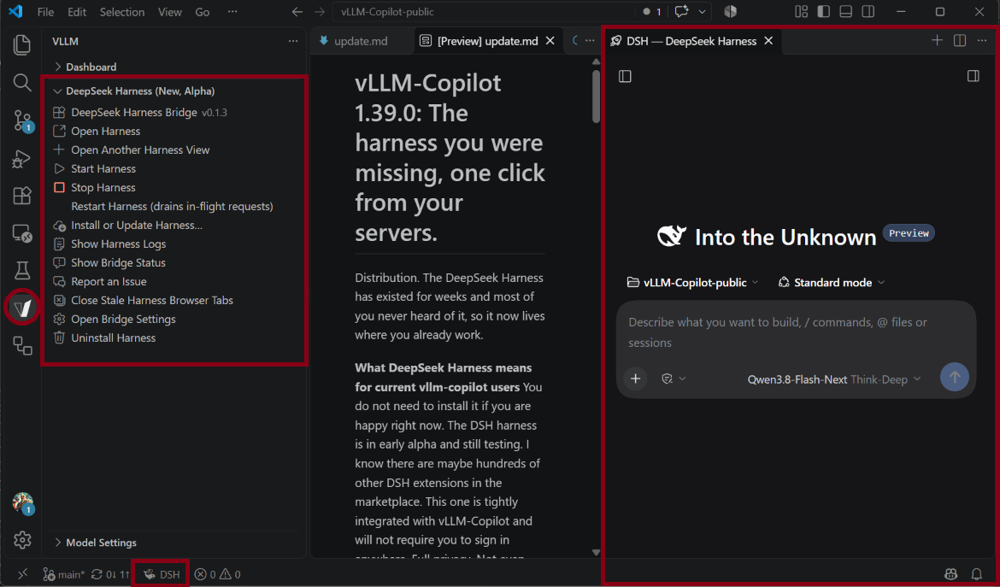

# The DeepSeek Harness is now built into vLLM-Copilot.

One extension, two interfaces. The agent harness that used to be a separate extension now lives here, on the servers you already configured - and in editors with no Copilot at all.

**If you never installed the bridge, nothing changed for you.** The harness is optional and dormant: until you install it there are no harness folders, no status-bar pill, no timers and no notifications. When you want it, open the **DeepSeek Harness** section under the **V** icon and press **Install DeepSeek Harness…**.

**If you used the DeepSeek Harness Bridge: uninstall it.** While that extension (`System-Sciences.dsh-bridge`) is installed, vLLM-Copilot tells you so and refuses to install or start its own harness, because two harnesses on one machine would fight over one runtime directory, one pid record and one port. Your old harness sessions stay in the bridge's own storage folder and are not carried over. Then install the harness from the sidebar: it checks Node.js 22+, `npm` and `pnpm`, names whatever is missing, and downloads the certified harness once - a few minutes, and later starts take seconds.

**Your harness settings did not move.** They were renamed from `dsh-bridge.*` to `vllm-copilot.harness.*`, and nothing is migrated: set them again in the **DeepSeek Harness** settings section, or run **DeepSeek Harness: Open Harness Settings**.

**It works without Copilot.** In VSCodium or any editor with no Copilot, install this extension from Open VSX, add a model, install the harness from the sidebar, and the agent runs on your servers with its tools, its sessions and your personalities.

**Personalities finally reach the harness.** A personality you picked in Model Settings now applies to harness requests too; the old bridge could only pass a personality file you had given an absolute path to, so every built-in preset was ignored there. Harness traffic still lands in the same dashboard totals. Providers you add inside the harness itself do not - see the [README FAQ](https://github.com/fuzzifikation/vLLM-Copilot#can-i-add-other-providers-inside-the-harness).

**VS Code 1.140 is the new minimum**, the harness's floor, because this extension supports current editor versions only.

## If you skipped 1.38

This page opens once per installed version, so for most of you it is the only news you get. What 1.38.0 to 1.39.0 changed, and still holds:

- Sixteen presets for this year's releases - Nemotron-3 and 3.5, Gemma 4, Tencent Hy4, inclusionAI Ling, Qwen3.8, Mistral Large 4 and Small 4, Poolside Laguna, Ornith, StepFun Step-3.5-Flash - each with the thinking-off switch and effort rungs its own chat template accepts, and an output ladder from its documented window. Presets are served live from the repository, so new ones reach you the day they land.
- A mode that is an effort level answers to Microsoft's own name (`none` through `max`), so the picker shows VS Code's wording and the Agents window stops hiding choices it cannot render; a mode that is a behavior keeps its name (`Think-Coding`, `Agent`, `Chat-Fast`). Your entries renamed themselves on the next start, every parameter intact; an older chat needs one mode reselection.
- No preset value is a guess: each came from that model's `chat_template.jinja`, its config files, or one explicit sentence on its card. Where a card gave only a range, the preset sets nothing and your checkpoint keeps authority - which is why Qwen3.8-2.4T and Mistral Large 4 ship no thinking-off mode: both reject a reasoning-off request outright.
- Selecting a mode the model does not offer now falls back to that model's default mode and logs the substitution; before, it applied no mode parameters at all and a thinking model silently stopped thinking.
- Personalities strip Microsoft's boilerplate again, and their rules anchor the prompt wording the Agents window ships today - a rename on Microsoft's side no longer leaves your persona unapplied.
- Local chat stays the complete experience: Output Length needs it, and so does any tool list longer than the 128 tools the Agents window sends for BYOK.

## Microsoft still owes you six fixes

All six have open reports at microsoft/vscode, filed by us. Add your reproduction; Microsoft moves when reports pile up:

- [microsoft/vscode#347351](https://github.com/microsoft/vscode/issues/347351) - the 128-tool ceiling
- [microsoft/vscode#340138](https://github.com/microsoft/vscode/issues/340138) - model modes and Output Length missing from the picker
- [microsoft/vscode#333413](https://github.com/microsoft/vscode/issues/333413) - picker settings stale after an update
- [microsoft/vscode#333802](https://github.com/microsoft/vscode/issues/333802) - subagents reject your BYOK models
- [microsoft/vscode#326597](https://github.com/microsoft/vscode/issues/326597) - historical thinking dropped before we see it
- [microsoft/vscode#321761](https://github.com/microsoft/vscode/issues/321761) - reserved output room ignores your output cap

Everything else that bites you is ours: [report it](https://github.com/fuzzifikation/vLLM-Copilot/issues) and we take it from there.

[Setup and remaining limitations](https://github.com/fuzzifikation/vLLM-Copilot#known-issues)